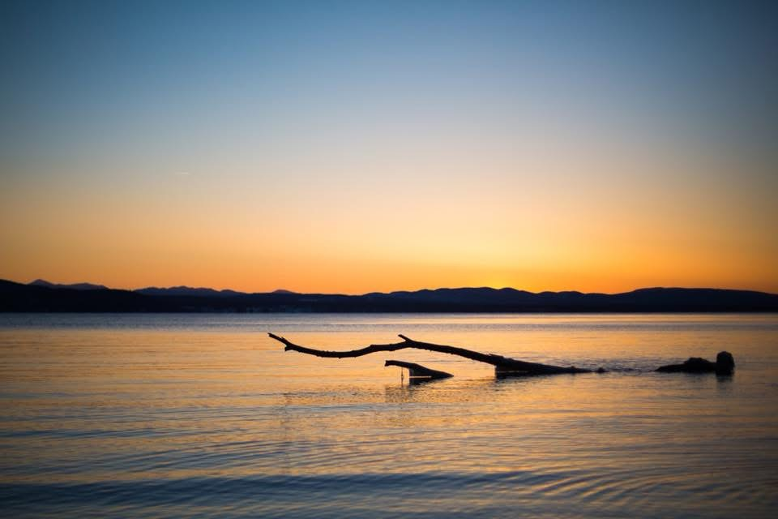

This is the second post because I want it to look like its a filled post to try the pinned writer card on the left and check the space thing on the right.

I think I need to make a previous post menu below the latest post. The latest post should be in full view, then anything before maybe preview? So people dont have to press twice to read the latest update. Ask Claude.

*This is also in Vermont lol.*
